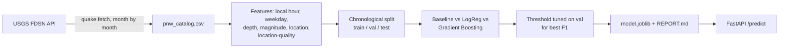

# Earthquake vs. Quarry Blast Classifier (Pacific Northwest)

Seismic networks record thousands of events a year, and some of them aren't earthquakes at all. They're **quarry and mining blasts**. Mislabeled blasts contaminate the earthquake catalogs used for hazard studies, so networks spend analyst time separating them.

This project trains a model to make that call automatically. It uses the public **USGS earthquake catalog** for Washington and Oregon, which already labels events as `earthquake`, `quarry blast`, or `explosion`.

**Stack:** Python, pandas, scikit-learn (logistic regression, gradient boosting), matplotlib, and a FastAPI prediction service.

## Pipeline



## Design decisions to talk about in interviews

- **Time-based split, not a random one.** The model trains on the past and is tested on the newest 20% of events, the way it would be used in practice. A random split leaks information, such as the same quarry blasting the same week, into the test set.
- **PR-AUC as the main metric.** Blasts are a small minority of events, so 90%+ accuracy is possible by always predicting "earthquake." Precision-recall AUC reflects how well the model actually finds blasts.
- **Threshold tuning on a separate validation period.** The 0.5 default isn't optimal for imbalanced data. The threshold is chosen on validation data and never on the test set.
- **Domain features.** Blasts happen on weekday working hours, at the surface. Local hour uses cyclic sin/cos encoding so 11 PM sits next to 1 AM, and it's converted to Pacific time with daylight saving handled.
- **Permutation importance** shows which features the model actually relies on.
- **Honest baseline.** A prior-only dummy model is in every comparison.

## Quickstart

```bash
python -m venv .venv && source .venv/bin/activate
pip install -r requirements-dev.txt

python -m quake.fetch --start 2015-01-01 --end 2025-01-01   # ~10 years, a few minutes
python -m quake.train                                       # writes reports/REPORT.md
uvicorn quake.api:app --reload                              # http://localhost:8000/docs
```

Example request:

```bash
curl -X POST localhost:8000/predict -H 'Content-Type: application/json' -d '[
  {"time":"2024-06-12T21:00:00Z","latitude":45.55,"longitude":-122.40,"depth":0.3,"mag":1.4}
]'
```

## Results

Results on the real USGS catalog haven't been recorded here yet. Run `python -m quake.fetch` and then `python -m quake.train` to produce `reports/REPORT.md` (test PR-AUC, precision, recall and F1 for the prior baseline, logistic regression and gradient boosting) plus the precision-recall and hour-of-day charts in `reports/`.

> `python -m quake.train --synthetic` runs the whole pipeline on generated fake data, for testing without internet. Its report is stamped **SYNTHETIC** and its numbers mean nothing.

## Tests

`pytest -q` covers:

- month-window pagination
- API retry and empty-response handling
- labeling and timezone-correct features
- chronological split ordering
- threshold selection
- an end-to-end training run that must beat the baseline
- the prediction API

## Ideas to extend

- Add a "distance to nearest known quarry" feature, computed from training-period blasts only to avoid leakage.
- Use waveform features (spectral ratios) from IRIS/EarthScope data. That's how seismologists do it for real.
- Track experiments with MLflow, and retrain monthly with a GitHub Actions schedule.
