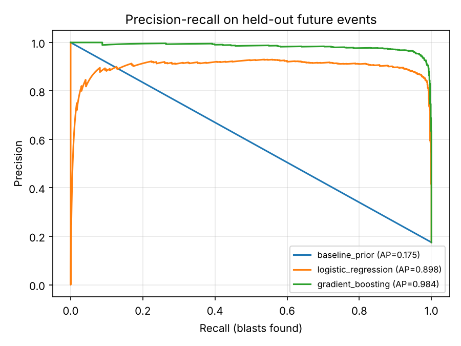
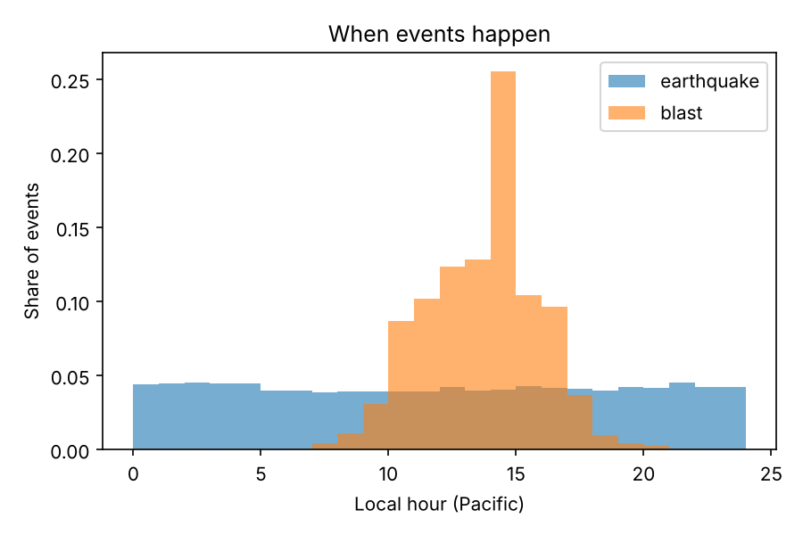

# Model report

- Events: 30,284 (blast rate 19.2%)
- Train: 2015-01-01T05:07:30.730Z → 2023-06-10T04:22:23.870Z (24,227)
- Test: 2023-06-10T08:32:59.540Z → 2024-12-31T18:34:22.010Z (6,057)
- Selected model: **gradient_boosting** (by validation PR-AUC)

| Model | Val PR-AUC | Test PR-AUC | Test ROC-AUC | Precision | Recall | F1 |
|---|---|---|---|---|---|---|
| baseline_prior | 0.2138 | 0.175 | 0.5 | 0.0 | 0.0 | 0.0 |
| logistic_regression | 0.945 | 0.8982 | 0.9883 | 0.8807 | 0.9472 | 0.9127 |
| gradient_boosting | 0.9955 | 0.9837 | 0.9972 | 0.9375 | 0.9764 | 0.9566 |

## Most important features (permutation, Δ PR-AUC)

| Feature | Importance |
|---|---|
| depth | 0.3836 |
| hour_cos | 0.0257 |
| longitude | 0.0253 |
| latitude | 0.0233 |
| mag | 0.0189 |
| day_of_week | 0.0056 |
| hour_sin | 0.0039 |
| gap | 0.0032 |

